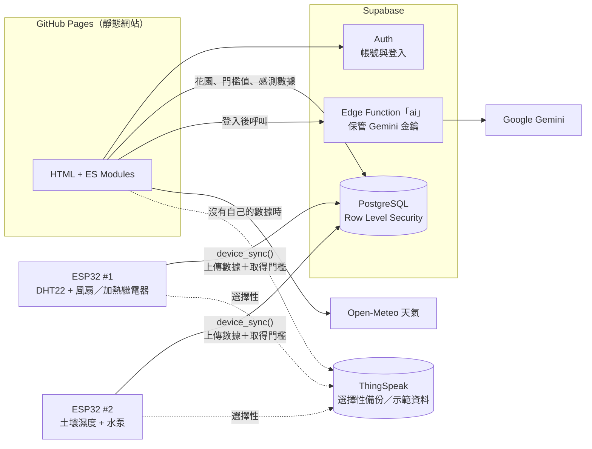

# 🌱 園藝智能助理 Horticulture Assistant

> 國立高雄大學 資訊管理學系 畢業專案 · 115 專題小組 · 指導老師：丁一賢 教授
> 第十三屆激發學生創意競賽「創業實作組」參賽作品

結合 **生成式 AI**、**IoT 感測器** 與 **氣象資料** 的智慧園藝平台。使用者輸入想種的植物，系統會判斷生長週期、建立種植專案，並依照生長階段、當地天氣與即時感測數據，每天產生具體的照護指南；ESP32 裝置則依使用者在網站上設定的門檻自動澆水與控溫。

**網站：** https://alanpass.github.io/Capstone_Project/

## 功能

| 模組 | 說明 |
| --- | --- |
| 會員帳號 | 註冊（Email 驗證）、登入、忘記密碼、個人資料（地址用於查詢天氣） |
| 植物百科 | **1000 種植物**，依蔬菜、香草、水果、花卉、蘭花、多肉、觀葉、蕨類、樹木、水生、食蟲等 11 類分類；可用「新手友善」「寵物友善」「可以吃」「室內也能種」等生活化條件快速篩選，詳細頁提供日照、澆水、溫度、繁殖與寵物安全等照護重點 |
| AI 種植規劃 | Gemini 驗證植物名稱並估算生長週期，建立種植專案；可查看今日或任一天的照護指南（結果會快取） |
| 我的花園 | 同時管理多個種植專案，顯示天數、生長階段與進度；可手動「調整進度」到實際的生長階段或天數 |
| IoT 監測 | ESP32 每分鐘上傳土壤濕度、氣溫、空氣濕度，網站自動更新數值、折線圖與紀錄 |
| 裝置狀態 | 每塊 ESP32 是否在線、風扇／加熱／水泵是否運轉、Wi-Fi 訊號、運作時間、套用中的門檻，以及「開風扇：25°C 高於 18°C」這類控制紀錄（每 30 秒自動更新） |
| 自動控制 | 可登記多塊 ESP32，**分別指定每塊裝置管理哪一株植物**（或使用手動門檻）。AI 為每株植物建議 5 個生長階段（種植／成長／開花／結果／收成）的溫度、濕度與澆水門檻，資料庫每天依植物目前階段自動切換，ESP32 下一次同步就套用：過熱開風扇、過冷開加熱、土壤太乾澆水 |

## 網站導覽

登入後的選單依使用情境分成五類，同一類的頁面頂端有分頁標籤可以互相切換；主控台的「開始使用」清單會依完成進度提示下一步（設定地址 → 建立種植專案 → 登記 ESP32 → 指定管理的植物 → 裝置上線）。

| 選單 | 頁面 |
| --- | --- |
| 主控台 | 今日天氣、環境數據、裝置摘要、我的植物 |
| 我的植物 | 我的花園、種植規劃・照護指南 |
| 智慧設備 | 裝置狀態、環境數據、自動控制 |
| 植物百科 | 分類瀏覽、快速篩選、植物詳細頁 |
| 帳號 | 個人資料、登出 |

## 系統架構

全部使用託管服務的免費方案，**不需要自己維護任何伺服器**：



| 元件 | 用途 |
| --- | --- |
| GitHub Pages | 網站本體；推送到 `main` 自動部署 |
| Supabase Auth | 註冊、登入、Email 驗證、重設密碼 |
| Supabase PostgreSQL | 個人資料、種植專案、AI 指南快取、門檻值、感測數據；**Row Level Security** 確保每個人只能存取自己的資料 |
| Supabase Edge Function | 唯一需要密鑰的地方：保管 Gemini 金鑰、固定提示詞、限制每人每小時 30 次 |
| Open-Meteo | 天氣預報（免金鑰） |
| ThingSpeak | 選擇性：ESP32 同時備份數據；網站在使用者還沒有裝置數據時顯示頻道資料作為示範 |

## 專案結構

```
├── frontend/                   靜態網站
│   ├── *.html                  各頁面（只有結構，邏輯在 assets/js/pages/）
│   ├── assets/css/app.css      共用樣式
│   ├── assets/js/
│   │   ├── config.js           ← 部署時要填的設定（Supabase 網址與金鑰）
│   │   ├── supabase.js         Supabase 用戶端
│   │   ├── session.js          帳號：註冊、登入、重設密碼、個人資料
│   │   ├── garden.js           種植專案與 AI 指南快取
│   │   ├── ai.js               呼叫 Edge Function
│   │   ├── sensors.js / charts.js   感測數據與折線圖
│   │   ├── weather.js / growth.js   天氣、生長天數與階段
│   │   ├── devices.js          裝置狀態總覽（連線、繼電器、控制紀錄）
│   │   ├── catalog.js          植物百科分類與快速篩選
│   │   └── ui.js / guide.js    導覽列與共用介面
│   └── data/
│       ├── plants-index.json   植物百科 1000 種（由 tools/build_catalog.py 產生）
│       └── plants.json         原有 100 種植物的完整照護資料
├── supabase/
│   ├── schema.sql              資料表、RLS 規則、裝置函式（貼到 SQL Editor 執行）
│   ├── functions/ai/index.ts   Edge Function（AI）
│   └── tests/                  在 PGlite 中驗證 schema 與 RLS
├── iot/                        ESP32 MicroPython 程式
├── tests/                      前端邏輯單元測試
├── tools/
│   ├── build_catalog.py        由 plant_data/*.txt 產生植物百科索引並抓取維基百科圖片
│   ├── plant_data/             新增 900 種植物的資料（每行一種，格式見 build_catalog.py）
│   └── build_plant_catalog.py  由舊版資料產生原有 100 種植物
└── docs/                       專案文件與參賽證明
```

## 部署步驟

> 需要的帳號：GitHub（已有）、[Supabase](https://supabase.com)、[Google AI Studio](https://aistudio.google.com)（取得 Gemini 金鑰）。全部免費。

### 1. 建立 Supabase 專案與資料庫
1. 到 https://supabase.com/dashboard 建立新專案（Region 選 **Northeast Asia (Tokyo)** 或 Singapore）。
2. 左側 **SQL Editor** → New query → 貼上 [`supabase/schema.sql`](supabase/schema.sql) 全部內容 → **Run**。

### 2. 設定登入
1. **Authentication → URL Configuration**
   - Site URL：`https://alanpass.github.io/Capstone_Project/`
   - Redirect URLs 加入：`https://alanpass.github.io/Capstone_Project/**`、`http://localhost:5500/**`
2. （選擇）**Authentication → Sign In / Providers → Email**：免費方案的驗證信每小時有寄送上限，展示時可關閉「Confirm email」讓註冊後直接登入。

### 3. 部署 AI（Edge Function）
1. 到 https://aistudio.google.com/apikey 建立 Gemini API 金鑰。
2. Supabase **Edge Functions → Secrets**：Key 填 `GEMINI_API_KEY`、Value 填你的金鑰 → Save。
3. **Edge Functions → Deploy a new function → Via Editor**：名稱填 `ai`，貼上 [`supabase/functions/ai/index.ts`](supabase/functions/ai/index.ts) 全部內容 → Deploy。
4. 在函式的 **Details** 頁，若有「Verify JWT / Enforce JWT verification」選項請關閉（程式內已自行驗證登入狀態，也支援新版金鑰）。

### 4. 連接網站
1. 專案頁上方按 **Connect**（或 **Project Settings → API Keys**），複製 Project URL 與 Publishable key（`sb_publishable_` 開頭）。
2. 填入 [`frontend/assets/js/config.js`](frontend/assets/js/config.js) 的 `SUPABASE_URL`、`SUPABASE_PUBLISHABLE_KEY`，推送到 GitHub 即自動部署。
   這兩個值本來就是公開的，資料安全由 RLS 保護；**絕對不要**填 `service_role` / secret key。

### 5. ESP32
1. 燒錄 [MicroPython 韌體](https://micropython.org/download/ESP32_GENERIC/)。
2. 登入網站 → 自動控制 →「新增裝置」，選擇這塊 ESP32 要管理哪一株植物，複製它的權杖（每塊 ESP32 各用一組）。
3. 把 `iot/config.example.py` 複製成 `config.py`，填入 Wi-Fi、Supabase 網址與 Publishable key、裝置權杖。
4. 用 Thonny 上傳 `common.py`、`config.py`，以及節點的 `main.py`（`climate_node/` 或 `soil_node/`）。

| 節點 | 接線 |
| --- | --- |
| `climate_node` 溫控 | DHT22 DATA → GPIO23、風扇繼電器 IN → GPIO5、加熱（PTC）繼電器 IN → GPIO4 |
| `soil_node` 澆水 | 土壤感測器 AOUT → GPIO34、水泵繼電器 IN → GPIO26 |

繼電器模組若是低電位觸發，把 `main.py` 的 `RELAY_ON` 改成 `0`。

### 6. ThingSpeak（選擇）
- 網站在使用者還沒有裝置數據時，會顯示 ThingSpeak 頻道 `3018608` 作為示範：到頻道 **Sharing** 選「Share channel view with everyone」即可讀取。
- 想讓 ESP32 同時備份到 ThingSpeak，在 `config.py` 填 `THINGSPEAK_WRITE_KEY`。

## 本機開發與測試

```bash
python -m http.server 5500 --directory frontend   # 開啟 http://localhost:5500
deno task test                                     # 前端邏輯 + Edge Function + 資料庫 RLS，共 26 項
```

## 重構重點

- **安全性**：程式碼中沒有任何密鑰；資料庫每張表都啟用 Row Level Security；ESP32 使用可隨時重新產生的裝置權杖，只能呼叫 `device_sync()`；AI 只接受登入使用者、提示詞固定在伺服器端並限制使用次數；所有動態內容渲染前先跳脫，AI 回應為結構化 JSON。
- **架構**：移除 Flask、Render、MySQL、ngrok、Firebase，改為 GitHub Pages + Supabase；ESP32 一個請求同時完成「上傳數據」與「取得門檻」。
- **IoT**：感測數據存在自己的資料庫，網站自行繪製折線圖；土壤濕度在裝置端換算成百分比，與網站門檻意義一致；資料保留 90 天並有防洪限制。
- **修正**：種植天數依使用者當地日期計算；土壤濕度原始值原本一律被截成 100%；註冊地址欄位原本讀不到；部分損毀的植物圖片。
- **效能**：同一天的 AI 指南會快取；圖片由 13 MB 壓縮為約 2.5 MB（WebP）；植物百科為靜態 JSON。
- **品質**：26 項自動化測試（含在 PostgreSQL 中實際驗證 RLS），GitHub Actions 每次推送自動執行。
