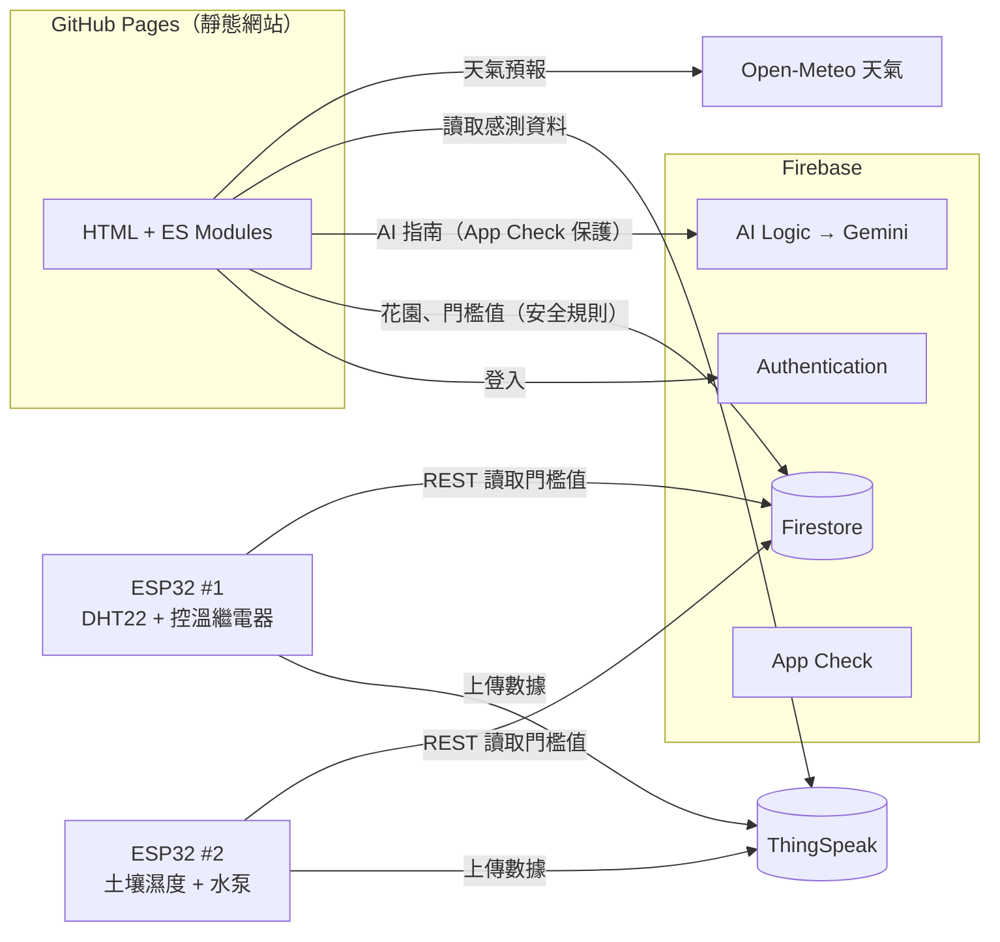

# 🌱 園藝智能助理 Horticulture Assistant

> 國立高雄大學 資訊管理學系 畢業專案 · 115 專題小組 · 指導老師：丁一賢 教授
> 第十三屆激發學生創意競賽「創業實作組」參賽作品

結合 **生成式 AI**、**IoT 感測器** 與 **氣象資料** 的智慧園藝平台。使用者輸入想種的植物，系統會判斷生長週期、建立種植專案，並依照生長階段、當地天氣與即時感測數據，每天產生具體的照護指南；ESP32 裝置則依使用者在網站上設定的門檻自動澆水與控溫。

**網站：** https://alanpass.github.io/Capstone_Project/

## 功能

| 模組 | 說明 |
| --- | --- |
| 會員帳號 | Firebase Authentication 註冊、登入、忘記密碼、個人資料（地址用於查詢天氣） |
| 植物百科 | 100 種植物的澆水、日照、溫度、土壤、修剪、繁殖、毒性資訊，可搜尋／篩選／排序 |
| AI 種植規劃 | Gemini 驗證植物名稱並估算生長週期，建立種植專案；可查看今日或任一天的照護指南 |
| 我的花園 | 同時管理多個種植專案，顯示天數、生長階段與進度 |
| IoT 監測 | ESP32 上傳土壤濕度、氣溫、空氣濕度至 ThingSpeak，網站即時顯示圖表與紀錄 |
| 自動控制 | 在網站設定溫濕度與土壤濕度門檻，ESP32 自動啟動控溫繼電器與澆水泵 |

## 系統架構（Serverless）

不需要任何自架伺服器：網站是 GitHub Pages 上的靜態檔，其餘全部使用雲端託管服務，免費方案即可運作。



| 需求 | 舊版做法 | 新版做法 |
| --- | --- | --- |
| 呼叫 Gemini | Flask 代理（Render），金鑰寫在程式碼 | **Firebase AI Logic**：金鑰由 Firebase 保管，App Check 防濫用 |
| 天氣 | 中央氣象署 API（需金鑰、需後端轉發） | **Open-Meteo**（免金鑰、瀏覽器直接呼叫） |
| 感測資料 | 後端轉發 ThingSpeak | 瀏覽器直接讀取公開頻道 |
| 花園資料 | 後端 Admin SDK，信任前端傳來的 user_id | 前端直接存取 Firestore，**安全規則**限制只能存取自己的資料 |
| ESP32 門檻值 | Firestore → 本機 MySQL 同步 → Flask → ngrok | ESP32 直接呼叫 **Firestore REST API** |
| 植物百科 | 瀏覽器登入後寫入 Firestore | 靜態 JSON，隨網站一起部署 |

## 專案結構

```
├── frontend/                 靜態網站（部署到 GitHub Pages）
│   ├── *.html                各頁面（只有結構，邏輯在 assets/js/pages/）
│   ├── assets/css/app.css    共用樣式
│   ├── assets/js/            共用模組
│   │   ├── config.js         Firebase 設定、Gemini 模型、App Check 金鑰
│   │   ├── ai.js             Firebase AI Logic 提示詞與結構化輸出
│   │   ├── garden.js         種植專案與 AI 指南快取（Firestore）
│   │   ├── growth.js         生長天數／階段計算
│   │   ├── weather.js        Open-Meteo 天氣
│   │   ├── sensors.js        ThingSpeak 感測資料
│   │   └── session.js / ui.js / guide.js / catalog.js
│   └── data/plants.json      植物百科資料
├── iot/                      ESP32 MicroPython 程式（climate_node、soil_node、common、config.example）
├── tests/                    邏輯單元測試（node --test）
├── tools/                    build_plant_catalog.py：由舊版資料產生植物百科
├── firestore.rules           Firestore 安全規則
└── docs/                     專案文件與參賽證明
```

## 部署步驟（一次性設定）

1. **GitHub Pages**：repo Settings → Pages → Source 選 *GitHub Actions*。之後每次推送到 `main` 都會自動部署 `frontend/`。
2. **Firebase Authentication**：Authentication → 設定 → 授權網域，加入 `alanpass.github.io`。
3. **Firestore 規則**：Firestore → 規則，貼上 [`firestore.rules`](firestore.rules) 並發布。
4. **Firebase AI Logic**：Firebase Console → AI Logic → 開始使用 → 選 *Gemini Developer API*（免費方案即可）。
5. **App Check**（AI Logic 預設強制）：
   1. Google Cloud Console → Security → reCAPTCHA，建立「網站」類型金鑰，網域填 `alanpass.github.io`，不要勾選核取方塊驗證。
   2. Firebase Console → App Check → 應用程式，用 reCAPTCHA Enterprise 註冊網頁應用程式並填入金鑰。
   3. 把金鑰填進 `frontend/assets/js/config.js` 的 `RECAPTCHA_ENTERPRISE_SITE_KEY` 後推送。
6. **ESP32**：燒錄 [MicroPython 韌體](https://micropython.org/download/ESP32_GENERIC/)，把 `iot/config.example.py` 複製成 `config.py` 並填值，用 Thonny 上傳 `common.py`、`config.py` 與對應節點的 `main.py`。

## 本機開發

```bash
python -m http.server 5500 --directory frontend
```

開啟 http://localhost:5500 。本機使用 AI 功能時，App Check 會改用除錯權杖：第一次執行後到瀏覽器 Console 複製權杖，登記到 Firebase Console → App Check → 應用程式 → 管理除錯權杖。

測試（需要 Node.js 20+）：

```bash
node --test tests/
```

## 重構重點

- **安全性**：移除程式碼中所有寫死的金鑰；資料存取改由 Firestore 安全規則把關（只能讀寫自己的花園與設定、檢查欄位型別）；AI 呼叫受 App Check 保護；所有動態內容渲染前先跳脫，AI 回應改為結構化 JSON，不再直接插入 AI 產生的 HTML。
- **架構**：移除 Flask、Render、MySQL、ngrok，改為 Serverless；部署只剩「推送到 GitHub」。
- **IoT**：ESP32 直接讀取 Firestore；土壤濕度在裝置端換算成百分比，與網站門檻意義一致。
- **修正**：種植天數依使用者當地日期計算；土壤濕度 ADC 原始值原本一律被截成 100%；註冊時存的地址欄位原本讀不到；部分損毀的植物圖片。
- **效能**：同一天的 AI 指南會快取在 Firestore；圖片由 13 MB 壓縮為約 2.5 MB（WebP）；植物百科改為靜態 JSON。
- **介面**：統一設計、手機版選單、載入與錯誤狀態、登入後自動回到原頁面。
