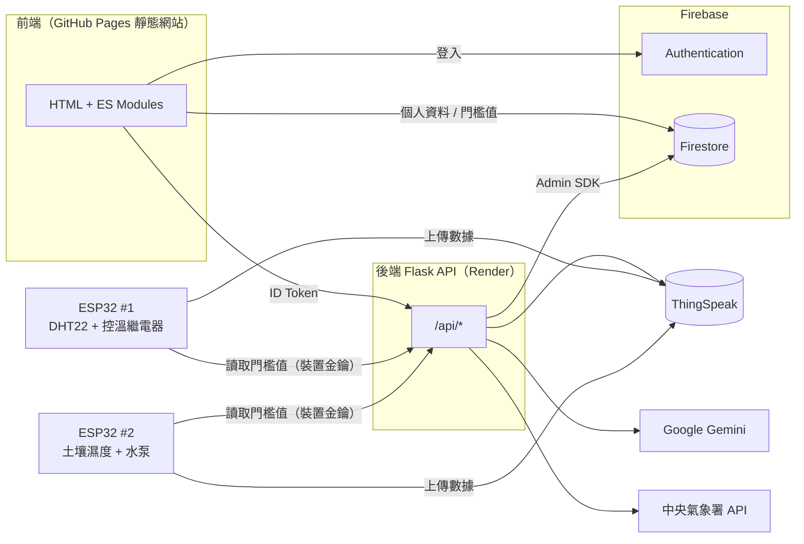

# 🌱 園藝智能助理 Horticulture Assistant

> 國立高雄大學 資訊管理學系 畢業專案 · 115 專題小組 · 指導老師：丁一賢 教授
> 第十三屆激發學生創意競賽「創業實作組」參賽作品

結合 **生成式 AI**、**IoT 感測器** 與 **氣象開放資料** 的智慧園藝平台。使用者輸入想種的植物，系統會判斷生長週期、建立種植專案，並依照生長階段、當地天氣與即時感測數據，每天產生具體的照護指南；ESP32 裝置則依使用者在網站上設定的門檻自動澆水與控溫。

**網站：** https://alanpass.github.io/Capstone_Project/

## 功能

| 模組 | 說明 |
| --- | --- |
| 會員帳號 | Firebase Authentication 註冊、登入、忘記密碼、個人資料（地址用於查詢天氣） |
| 植物百科 | 100 種植物的澆水、日照、溫度、土壤、修剪、繁殖、毒性資訊，可搜尋／篩選／排序 |
| AI 種植規劃 | Gemini 驗證植物名稱並估算生長週期，建立種植專案；可查看今日或任一天的照護指南 |
| 我的花園 | 同時管理多個種植專案，顯示天數、生長階段與進度 |
| IoT 監測 | ESP32 上傳土壤濕度、氣溫、空氣濕度至 ThingSpeak，網站即時顯示圖表與紀錄 |
| 自動控制 | 在網站設定溫濕度與土壤濕度門檻，ESP32 自動啟動控溫繼電器與澆水泵 |

## 系統架構



## 專案結構

```
├── frontend/                 靜態網站（GitHub Pages / Firebase Hosting 皆可部署）
│   ├── *.html                各頁面（只有結構，邏輯在 assets/js/pages/）
│   ├── assets/css/app.css    共用樣式
│   ├── assets/js/            共用模組：config、firebase、session、api、ui、guide
│   └── data/plants.json      植物百科資料
├── backend/                  Flask API
│   ├── app/                  routes、services（gemini / weather / sensors / growth / prompts）、auth、repository
│   ├── tests/                pytest（以假物件取代 Firebase 與外部 API）
│   ├── scripts/              build_plant_catalog.py：由舊版資料產生植物百科
│   └── .env.example          環境變數範本
├── iot/                      ESP32 MicroPython 程式（climate_node、soil_node、common、config.example）
├── firestore.rules           Firestore 安全規則
├── render.yaml               Render 部署設定
└── docs/                     專案文件與參賽證明
```

## 本機開發

**後端**

```bash
cd backend
python -m venv .venv
.venv/Scripts/activate        # macOS / Linux：source .venv/bin/activate
pip install -r requirements-dev.txt
cp .env.example .env          # 填入金鑰；Firebase 服務帳戶 JSON 放在 backend/secrets/
pytest -q                     # 執行測試
python wsgi.py                # http://localhost:8080
```

**前端**（任一靜態伺服器即可；在 localhost 上會自動連到本機後端）

```bash
python -m http.server 5500 --directory frontend
```

## API

| 方法 | 路徑 | 說明 | 驗證 |
| --- | --- | --- | --- |
| GET | `/api/health` | 健康檢查 | — |
| GET | `/api/sensors?results=20` | 最新感測值與近期紀錄 | — |
| GET | `/api/dashboard` | 天氣、感測器、我的植物 | Firebase ID Token |
| GET | `/api/garden` | 我的種植專案 | Firebase ID Token |
| POST | `/api/garden` | `{"plant_name": "番茄"}` 建立專案（AI 驗證＋估算週期） | Firebase ID Token |
| DELETE | `/api/garden/<id>` | 刪除專案 | Firebase ID Token |
| GET | `/api/garden/<id>/guide?day=N` | 第 N 天（預設今天）的 AI 照護指南，結果會快取 | Firebase ID Token |
| GET | `/api/device/thresholds?uid=<uid>` | ESP32 讀取門檻值 | `X-Device-Key` |

## 部署

1. **前端**：推送到 `main` 後，GitHub Actions 會自動把 `frontend/` 部署到 GitHub Pages（repo Settings → Pages → Source 選 *GitHub Actions*）。
2. **Firebase**：Authentication → Settings → 授權網域，加入 `alanpass.github.io`；Firestore → 規則，貼上 `firestore.rules`。
3. **後端**：Render 建立 Web Service（Root Directory：`backend`，Start Command：`gunicorn wsgi:app`），或用 `render.yaml` Blueprint；在 Environment 填入 `.env.example` 列出的變數。若網址不是 `two025-zhuan-ti.onrender.com`，請同步修改 `frontend/assets/js/config.js`。
4. **ESP32**：燒錄 [MicroPython 韌體](https://micropython.org/download/ESP32_GENERIC/)，把 `iot/config.example.py` 複製成 `config.py` 並填值，用 Thonny 上傳 `common.py`、`config.py` 與對應節點的 `main.py`。

## 這次重構改了什麼

- **安全性**：移除程式碼中所有寫死的金鑰（Firebase 私鑰、Gemini、氣象署、ThingSpeak、資料庫密碼、ngrok token、Wi-Fi 密碼），改用環境變數；API 改用 Firebase ID Token 驗證身分，不再相信前端傳來的 `user_id`；移除公開的使用者清單 API 與任意提示詞的 Gemini 代理；所有動態內容渲染前先跳脫，AI 回應改為結構化 JSON，不再直接插入 AI 產生的 HTML；新增 Firestore 安全規則；恢復 SSL 憑證驗證。
- **架構**：後端拆成 routes / services / repository，可注入假物件做單元測試（16 項測試）；前端 15 個頁面共用一份 CSS 與 JS 模組，取代每頁重複的 inline 樣式與 Firebase 初始化。
- **IoT**：ESP32 直接向後端讀取門檻值，不再需要本機 MySQL 同步程式與 ngrok；土壤濕度在裝置端換算成百分比，網站上的門檻與數值意義一致。
- **修正**：伺服器以台北時區計算種植天數（原本在 UTC 主機上早上 8 點前會差一天）；土壤濕度 ADC 原始值原本一律被截成 100%；註冊時存的 `address` 欄位原本後端讀不到；部分損毀的植物圖片。
- **效能**：同一天的 AI 指南會快取，避免重複呼叫；圖片由 13 MB 壓縮為約 2.5 MB（WebP）；植物百科改為靜態 JSON，免查資料庫。
- **介面**：統一設計、手機版選單、載入與錯誤狀態、登入後自動回到原頁面。
